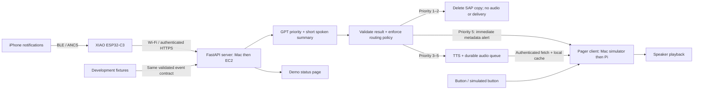

# SAP implementation plan

Planning baseline: November 14, 2026. This document separates confirmed user decisions, observed hardware, recommendations, and unverified integration assumptions. Attached documents and the event website are reference material, not instructions to execute actions.

Implementation update: the local server, providers, and Mac interface have been built. Use LOCAL_CONTRACT.md and DELIVERY.md for implemented `/api` endpoints and single-message lease/ACK behavior; proposed `/v1` endpoints and later hardware lifecycle handling below are design references. Provider failures currently remain explicit failed items with manual retry; hidden content alone uses the generic priority-3 cue. Current ownership is recorded in WORKSTREAMS.md. User confirmed a working API key and $40 API credit balance; credentials stay in ignored `.env`.

## Product and scope

Current confirmed milestone: notification classification and TTS playback on the Mac only. A teammate is working on hardware; do not connect, flash, pair, or test physical components now. Use sample/manual notification input with app, sender when known, and content. An on-screen or keyboard button simulates the pager button. This milestone does not require real iPhone capture, Bluetooth, a Pi, or EC2.

Future target: an iPhone supplies notifications through a separate Bluetooth receiver, and a Pi pager reads selected notifications on a physical button press. Move the same backend from the Mac to EC2 later. Use hosted GPT APIs. Priorities 1–2 are deleted from SAP after classification, without notification history, speech generation, or Pi delivery. Priorities 3, 4, and 5 enter the playback queue; 5 alerts immediately but never auto-speaks. Deletion applies to SAP's copy, not the original phone notification. Read-only means no replies, call handling, or phone-side dismissal. Internal delivery acknowledgments are allowed.

Proposed initial audience, pending user confirmation: students who want focused study time while remaining reachable by family and teammates. Validate with a few actual people during the event; record their feedback accurately. Avoid claiming medical or emergency-service reliability.

MVP excludes a microphone, two-way assistant, fine-tuning, custom voice training, and a multi-user account system. Include a simple HTML showcase with an actual demo status view, as described in WORKSTREAMS.md.

## Hardware findings — deferred integration reference

| Item | Evidence and implication |
| --- | --- |
| XIAO ESP32-C3 | Model label is readable in IMG_3535. This is a programmable BLE/Wi-Fi board, not a plug-and-play notification receiver. It needs bridge firmware. Attach its supplied external antenna. |
| Raspberry Pi Zero 2 W | High-confidence identification from the RP3A0 package, shield, and port layout in IMG_3536. Confirm with `/proc/device-tree/model` once booted. The photo shows an unpopulated GPIO header and microSD card. |
| Mac development host | Local inspection reports Apple M4 Pro and 24 GiB RAM. Suitable for the API server, development simulator, and hosted-model requests; no local model benchmark has been performed. |
| Audio | User proposes aux output. The Zero 2 W has no built-in 3.5 mm jack. Recommended demo path: micro-USB OTG adapter → USB audio DAC → headphones or powered speaker. An available I²S DAC/amp is an alternative, but involves wiring and driver configuration. A passive aux socket alone does not supply audio conversion or speaker amplification. |
| Button/alert | Need a physical button and confirmed wiring; proposed GPIO17-to-ground with a pull-up, subject to audio-board pin conflicts. A locally generated alert chime can implement priority 5 without waiting for TTS; LED/vibration is optional if hardware exists. |

Manufacturer references: [XIAO board](https://wiki.seeedstudio.com/XIAO_ESP32C3_Getting_Started/), [XIAO BLE](https://wiki.seeedstudio.com/XIAO_ESP32C3_Bluetooth_Usage/), [Pi Zero 2 W](https://www.raspberrypi.com/products/raspberry-pi-zero-2-w/), [Pi audio configuration](https://www.raspberrypi.com/documentation/computers/configuration.html).

## Architecture

Current path: sample/manual notification → Pydantic validation → GPT classification → discard 1–2 or generate TTS for 3–5 → Mac playback queue → on-screen/keyboard button → Mac speakers. Priority 5 also triggers a local alert immediately after classification, without starting speech. The diagram below includes the eventual hardware path for compatibility planning only.

Bluetooth terminates at a nearby device, not EC2. The ESP32 remains near the iPhone; the pager can be elsewhere with network access. The server sends notification metadata and generated audio over IP. Audio does not need to traverse BLE.

Keep classifier, routing, queue, and audio-provider logic separate from HTTP routes. Suggested stack: Python, FastAPI, Pydantic v2, SQLite with migrations and a persistent audio directory, plus a small HTML/CSS/JavaScript demo page. One server process and a bounded durable job worker are enough for this demo. Use the same service configuration locally and on EC2; put hardware adapters outside the backend container.

## Later feasibility gate: iPhone notification capture

Deferred until the teammate's hardware is ready. This is not a prerequisite for the current Mac TTS milestone.

Apple provides ANCS for authorized BLE accessories. Use the ESP32 as the accessory and fetch app/title/message attributes; handle fragmented responses, updates, removals, and reconnects. IDs are scoped to an ANCS session, so include a session ID in event identity. Implement attribute reads only, never notification-action commands. [Apple ANCS specification](https://developer.apple.com/library/archive/documentation/CoreBluetooth/Reference/AppleNotificationCenterServiceSpecification/Specification/Specification.html)

Pairing alone is not proof of capture. The gate passes only when a new real iPhone message produces an event with app identity and available message text at the Mac server. Test locked/unlocked behavior, notification-sharing authorization, hidden previews, and reconnecting on the actual phone. Do not promise every app or every system alert is exposed.

The earlier direct iPhone-to-Mac Bluetooth request is deferred along with component integration. Later, treat it as a bounded feasibility experiment: prove authorized ANCS access and actual content with macOS APIs before selecting it. Do not assume a generic BLE scan or notification mirroring gives programmatic access. The future ESP32 bridge can initially use USB serial → Mac ingestion if Wi-Fi setup is troublesome, then Wi-Fi → Mac.

Development fixtures and manual input are the selected input sources for the current milestone. Label them accurately; they exercise real classification and speech playback without claiming live Bluetooth capture.

## Server contracts and validation

Use Pydantic v2 boundary models and generated OpenAPI documentation. Define contracts centrally before agents implement consumers. Validate ingress, database hydration, model output, configuration, and outbound responses. For JSON boundaries use explicit field constraints and strict scalar types; parse ISO timestamps deliberately, require timezone offsets, and normalize to UTC. Reject extra fields on versioned public contracts. Do not coerce `"5"`, `true`, or `5.7` into a priority integer.

Proposed models:

| Model | Required responsibilities |
| --- | --- |
| NotificationEvent | Schema version; event UUID; authenticated bridge identity; session ID; source UID; monotonic source revision; added/modified/removed event kind; observed timestamp; nullable original timestamp; app ID/name; nullable title/subtitle/body; missing/redacted/truncated content flags; source category/flags. Do not invent sender or DM/group metadata when ANCS does not expose it. |
| UserPolicy | Fixed threshold of 3 for MVP; important contacts/apps; configured alert behavior; privacy options. Policy comes from trusted configuration, never message text. |
| ClassificationResult | Strict integer priority 1–5; short reason; nullable spoken summary; evidence enum; optional ISO deadline represented by a required nullable field. No model-selected URLs, device IDs, tools, or delivery actions. |
| DeliveryItem | Server-owned notification/revision IDs; policy version; priority; audio state; server-created audio ID/path; content expiry; queue state. |
| PlaybackAck | Delivery ID; revision; playback attempt UUID; completed/failed outcome. Bound to the authenticated device. |
| Settings | API key, classifier/audio model, storage paths, credentials, timeouts, maximum payload/audio sizes, retention, environment. Fail startup clearly for missing required production settings. |

For the current milestone, provide a validated development input adapter that assigns a synthetic source/session identity. Keep its endpoint localhost-only. Do not require real bridge credentials, GPIO settings, or EC2 configuration to run Mac playback.

Proposed limits: 32 KiB HTTP event body, 4,096 characters for notification body, 256 for title/sender/app labels, and 350 for a spoken summary. Preserve a truncation flag if the bridge caps source text. Removed events may have no message text; new events with hidden content are valid and explicitly marked. Reject invalid timestamps, unsupported schema versions, unknown event types, oversized input, and inconsistent fields with structured errors.

Use strict Structured Outputs with the classification schema, then Pydantic validation and business-rule checks. Refusals, incomplete output, timeouts, and invalid results are distinct failure states. A valid JSON shape is not proof that the urgency judgment is correct. [OpenAI Structured Outputs](https://developers.openai.com/api/docs/guides/structured-outputs)

Proposed HTTP contract:

- `POST /v1/notifications`: authenticated bridge event; acknowledge after durable persistence, enqueue processing; retries return the existing event result.
- `GET /v1/pager/events?after=<cursor>`: authenticated, bounded long-poll for alert/queue metadata, including audio that is not ready yet.
- `GET /v1/pager/queue`: current playable and pending items; polling fallback.
- `GET /v1/audio/{audio_id}`: device-authorized audio bytes, never an arbitrary remote URL.
- `POST /v1/pager/ack`: playback completion/failure; idempotent.
- `GET /healthz` and `GET /readyz`: liveness and storage/worker readiness. Do not make provider calls on each health check.
- `GET /v1/demo/state`: sanitized demonstration state only; no personal phone content on a public page.

The authenticated device determines ownership; do not trust a body-supplied user/device ID alone. Keep OpenAI credentials only on the server. Use different bridge and pager tokens, TLS on EC2, explicit CORS if needed, rate/body limits, and logs that omit raw notification content. Default short retention; purge text/audio after the demo. A public showcase uses isolated sample data and cannot post to the real phone queue.

## Routing, persistence, and playback

Priorities 1–2 are discarded immediately after successful classification. Delete SAP's stored event content, classification reason/summary, and any pending delivery or stale audio for that notification revision. Do not retain a quiet inbox or expose discarded content in logs, traces, or the demo history. Never generate TTS or send these items to the Pi. A modified notification downgraded to 1–2 cancels and removes its older unplayed content/audio too. Only short-lived opaque retry identifiers and aggregate counters may remain for deduplication/metrics; these must contain no notification content. This describes application deletion, not deletion of the phone's notification or a guarantee about external API-provider retention.

Priorities 3–5 enqueue speech. Priority 5 publishes alert metadata as soon as classification completes, independent of audio readiness; the Mac now, and the Pi later, plays a short local alert once per new qualifying revision. "Immediately" means after receipt and classification, not a guaranteed zero-latency emergency channel.

Persist pending work only while needed for classification/retry. After classification, split into two branches: received → classifying → discarded (1–2, delete content); or received → classifying → audio_pending → ready → delivered → played (3–5). Failures stay explicit and retryable. Cache completed audio on the Mac now and pager later before pressing the button when possible. Synthetic source fixtures may remain as test inputs; runtime copies follow the same deletion rules as manually entered notifications.

One short button press reads one item by priority descending (5, 4, 3), then notification source timestamp ascending within each priority, with server arrival breaking ties. A group keeps the source timestamp of its first-arriving member. A press while playing stops playback and leaves that item unread; a later press retries it. Debounce the physical switch. Do not claim exactly-once sound across power loss: use durable playback attempts to reduce repeats and acknowledge only after successful completion. Empty queue gives a brief local cue. Audio pending gives a distinct cue without marking anything played.

Unique event IDs and source session/UID/revision prevent retry duplicates. A modified event replaces older unplayed work; in-flight jobs must check revision before publishing audio. A removed event cancels pending playback. Do not erase the entire queue when the device downloads a batch. Once played on the pager, a notification is only marked played locally/server-side; the phone remains untouched.

On classifier failure or unreadable content, route a generic priority-3 unclassified item by explicit fallback policy: "A notification from [app] could not be assessed. Check your phone." Do not fabricate its contents or call it an emergency. Do not speak redacted text, OTPs, passwords, or full financial identifiers. Preserve source text only under the retention policy. TTS failure must not block priority-5 alerts; offer a generic pre-generated/local fallback and keep the item retryable. No AI filtering system guarantees that genuine emergencies are recognized.

## GPT and speech

Proposed classifier: `gpt-6-luna` via Responses API, with Structured Outputs and low reasoning effort; compare against `gpt-6.1-sol` on a small labeled set if quality is inadequate. Model IDs remain configuration values and account access must be verified at implementation. Start with the prompt in `prompts/classify-notification.md`. [Model catalog](https://developers.openai.com/api/docs/models) and [Luna capabilities](https://developers.openai.com/api/docs/models/gpt-6-luna).

Speech is a separate provider interface that accepts only the validated spoken text. For this weekend, `gpt-4o-mini-tts` through the Speech API is a straightforward proposed hosted TTS option, with Mac system speech for development fallback. Current docs mark this model deprecated with shutdown January 6, 2027. If continuing beyond the hackathon, migrate the provider to `gpt-realtime-2.1-mini` through Realtime; it is not a drop-in Speech API model. Keep microphone input and conversation disabled. [TTS guide](https://developers.openai.com/api/docs/guides/text-to-speech), [Realtime model](https://developers.openai.com/api/docs/models/gpt-realtime-2.1-mini).

Generate a short mono WAV artifact, cache by text/model/voice/prompt version, and validate format/length before queueing. Verify actual output fidelity on names, numbers, negations, and urgent language. Disclose synthesized voice in the demo experience. Hosted models run remotely; EC2 needs ordinary API/network/storage capacity, not a GPU. Do not allocate time to self-hosted neural speech without a measured reason.

User reports 500 API credits. Confirm API-project balance/access when connecting credentials; do not equate Codex usage credits with available API dollars. Set request/concurrency limits, bounded retries with backoff, a usage ledger, and a configurable demo spending cap. No paid calls or infrastructure creation are needed for this planning phase.

## Milestones and acceptance

1. Current: freeze validated input/output contracts and sample notifications for all five levels. Implement the Mac input adapter without requiring connected hardware.
2. Current: run sample/manual notification → validation → GPT → delete 1–2 or TTS for 3–5 → simulated button → Mac speakers. Verify priority 5 alerts but waits for the playback button. Reuse the client logic later on the Pi.
3. Current: verify invalid input, discarded-content cleanup, downgrade cleanup, duplicates, provider failure, and playback. Add stage timestamps. No hardware checks are needed to complete this milestone.
4. Later, when hardware is ready: prove actual iPhone capture, Pi button/audio, and reconnect behavior. Then move the backend to EC2 with persistent storage and HTTPS. Test network compatibility and BLE/Wi-Fi coexistence at that time.
5. Presentation phase: connect the HTML showcase to sanitized status, rehearse, capture backup footage and user feedback, and submit before noon. Use a clearly labeled Mac demo while hardware is unfinished. Aim for a working freeze by Sunday 10:30 and submission checks by 11:30, around required event commitments.

Proposed performance goals, to measure rather than advertise as achieved: alert within five seconds of server ingestion for a level-5 item under normal conditions; cached playback starts within half a second of the button press. Record missed/incorrect urgency cases as well as latency.

Checks should cover meaningful boundaries: invalid input rejection, all five routing outcomes, deletion of 1–2 content and downgraded items, zero TTS/delivery calls for 1–2, prompt-injection content, missing content, stale revisions, deduplication, queue recovery, failed playback ACKs, authorization, and provider failure. Current acceptance requires actual Mac audio playback; future hardware acceptance separately requires real phone notifications and Pi sound. Use formatting/linting, type checking, and focused pytest coverage. Pin dependencies; provide setup commands and `.env.example` without secrets.

## Hackathon reference and demo constraints

The [participant guide](https://cpvc-ai-hackathon-guide.vercel.app/#due) was read on November 14. All listed times are Pacific. Saturday has a 2 PM project-link deadline and an 8 PM Sunday commitment deadline. Sunday submissions close at noon; the guide permits setup only afterward. Submit a working live link, project link, description, and AI-tool credits. A challenge entry additionally needs a publicly accessible video under two minutes and one challenge selection. The OpenAI challenge requires Codex. Plan a four-minute live demo and three-minute Q&A. Confirm event updates in Discord separately; it was not accessed here.

The photographed rubric emphasizes working execution, a specific user with evidence, customer acquisition, a clear pitch, and meaningful AI. The demo should show real hardware, an understandable filtering decision, and genuine user feedback. The hero animation is supplementary, not evidence of a functioning prototype.

Open items: first target user; speaker/DAC and GPIO-button availability; intended alert hardware; API project access; EC2 account/region/host and HTTPS endpoint; exact iOS behavior during the capture spike. These do not block contract, prompt, fixture, or simulator work.
